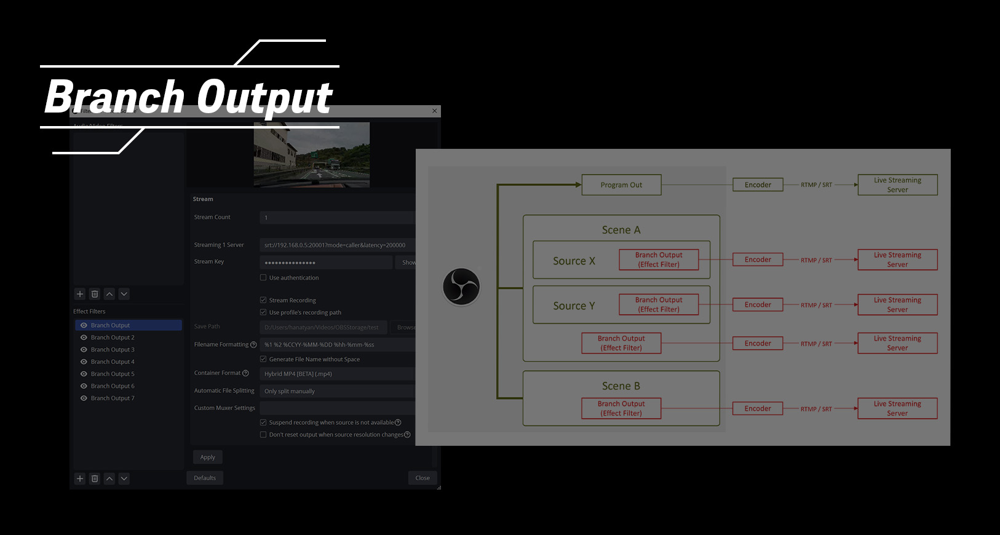
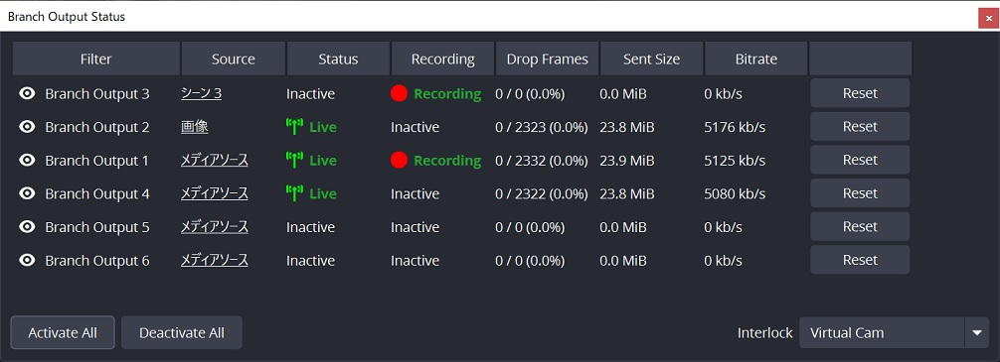

# Branch Output filter (The OBS Studio Plugin)

[日本語はこちら](./README_ja.md)

> ## Sponsor program
> 
> If you would like to help our projects, please support us.
>
> 
> 
> ### Sponsors (Thank you for your support)
> 
> [nhicks00](https://github.com/nhicks00)

## Features

This is an OBS Studio plugin that allows to live stream and/or recording for each source individually.
Inspired by the [Source Record](https://github.com/exeldro/obs-source-record) plugin, but more focused on streaming.
More reliable and proper audio handling.

- Added “Branch Output” to source or scene effect filters.
- One stream per Branch Output filter can be sent with dedicated encoding settings.
- Multiple Branch Outputs can be added to a single source or scene (as PC specs allow)
- Branch Output Selectable audio source for each filter (filter audio, any source audio, audio tracks 1-6)
- Automatically reconnects when disconnected
- Stream recording functionality (Various container formats, time and size division supported)
  
  (*) Works as recording only if connection information is left blank
  
- Status dock to check the status and statistics of all Branch Output filters. Support for batch or individual activation and deactivation
- Can be interlinked with OBS Studio's streaming, recording, virtual camera, and replay buffer status
- Manual splitting of recorded files (Since 1.0.5)
- Pause/Unpause Recording (Since 1.0.5)
- Adding chapter markers to recordings（On Hybrid MP4, requires OBS Studio 30.2 or later） (Since 1.0.5)
- Replay buffer per filter (Since 1.0.8)
- Filter input mode to capture and output video from the filter chain (Experimental, Since 1.0.8)
- Blanking and muting when the source is not visible in Program (Since 1.0.8)
- Per-profile Status Dock settings (Since 1.0.8)
- Video cropping with relative (margin) and absolute (region) modes, including a live preview rectangle (Since 1.0.9)
- Frame rate divider to reduce output frame rate (1/2, 1/3, 1/4, 1/5, 1/6) (Since 1.0.9)
- Individual start/stop control per output type via "Individual" interlock mode and per-output enable/disable checkboxes in the Status Dock (Since 1.0.9)
- Proc handler to override recording save file name format from scripts ([API reference](./API.md)) (Since 1.0.9)
- Proc handler to override replay buffer save file name format from scripts ([API reference](./API.md)) (Since 1.0.9)
- Hybrid MOV recording format with chapter marker support (Requires OBS Studio 32.0 or later) (Since 1.1.0)
- Program Output: stream, record, and run a replay buffer from OBS's Program (what OBS itself
  streams and records) instead of a source, added from the **+** button of the Status Dock
  (Since 1.1.0)
  - Multiple Program Outputs can be added, each with its own settings, outputs, and hotkeys like a
    filter
  - Program Outputs are saved per profile
- Proc handler to list Branch Output filters and Program Outputs from scripts
  (`osi_branch_output_get_output_list`) ([API reference](./API.md)) (Since 1.1.0)
- Overriding the recording and replay buffer save file name formats of Program Outputs from
  scripts, including the bundled sample scripts ([API reference](./API.md)) (Since 1.1.0)
- Various hotkeys
  - Enable/Disable the filter
  - Manual recording splitting, Pause/Unpause, Adding chapters (Since 1.0.5)
  - Enable/Disable all
  - Split all recordings, Pause/Unpause all recordings, Add chapter to all recordings (Since 1.0.5)
  - Save replay buffer, Save all replay buffers (Since 1.0.8)
  - Per-output enable/disable for streaming (all slots / per-slot), recording, and replay buffer (Since 1.0.9)
- Also available in Studio Mode
  - **Branch Output filters ignore Studio Mode's Program and always output the Preview's one**
  - **Program Outputs always output the Program (including transitions), not the Preview**
    (Since 1.1.0)

## Requirements

[OBS Studio](https://obsproject.com/) >= 30.1.0 (Qt6, x64/ARM64/AppleSilicon)

# Installation

Please download latest install package from [Release](https://github.com/OPENSPHERE-Inc/branch-output/releases)

# User manual

1. Add "Branch Output" as effect filters to any "Source" or "Scene" (NOTE: "Scene" has no audio defaultly)
2. Input server URL and stream key. The server URL can be RTMP or SRT etc. like OBS's custom stream settings.
3. Choose audio source. Un-checked custom audio source means use filter audio as source (NOTE: "Scene"
   must has custom audio source for it's sound)

   "Any Sources" will be captured after filter pipeline before Audio Mixer. Also "Audio track 1 ~ 6" will be captured from Audio Mixer output.  
   
   You can choose "No Audio" as well.  
   
4. Setup audio and video encoder. It's usable that hardware encoder such as NVENC.
5. Press Apply button and stream will be online.
6. When filter is inactivated via "Eye icon", output stream will be offline too.

(*) Some sources (e.g. Local Media source) will stop stream output during inactivated scene. It's not plugin's bug.

# TIPS

## 1. To change the resolution and layout for streaming (Work-around)

> Changing Resolution feature is integrated since 1.0.0
> 
> Below steps are alternative method with more flexibilities (Cropping, Zooming, Adding black bg etc...)

1. The canvas resolution is assumed to be 1080p.
2. Create new blank scene.
3. Right-click on the source you want to stream and click “Copy” from the menu.
4. Right-click on the blank scene created in step 2 and click “Paste (Reference)” from the menu.
   Scale and crop as needed.
5. Add Branch Output to the scene's effects filter and set up streaming

“Paste (Reference)” does not duplicate the source and will not cause device conflicts.

Branch Output will stream even if the scene is not active.

This method should work well except for some sources (e.g., media sources) that will not play unless the scene is active.

## 2. To stream the Program to multiple streaming platforms

There are two ways, depending on what you need.

- To stream the Program as it is, use a Program Output (method 1).
- To change the content for each streaming platform, or to apply other filters (such as rotation) to
  the Program, use the Main View Source plugin with a Branch Output filter (method 2).

### Method 1: Use a Program Output (Since 1.1.0)

1. Click the **+** button in the **Branch Output Status** dock and choose **Program**.
2. In the window that opens, check **Streaming** and choose the number of platforms in
   **Stream Count** (up to 8). For each platform, enter the server URL in **Streaming 1 Server**,
   **Streaming 2 Server**, and so on, and the stream key in the **Stream Key** below it.
3. Set up the audio and video encoders, and click **OK**.

The streams start according to the Status Dock's **Interlock** setting. Choose **Streaming** to
start and stop them together with OBS's own stream (this applies to every Branch Output).

The streams of one Program Output share its encoders. To send a different resolution or bitrate to
each platform, add a Program Output for each of them.

A Program Output sends the Program, including transitions, also in Studio Mode.

### Method 2: Use Main View Source with a Branch Output filter

> **Important note**: Work in studio mode to prevent video loops.

This uses the plugin [Main View Source](https://obsproject.com/forum/resources/main-view-source.1501/) along with Branch Output.

1. Create new blank scene (The scene for streaming)
2. Add a “Main View Source” to the scene for streaming.
3. Add Branch Output to the scene's effects filter and set up streaming.

This method suits the following cases.

- To change the content for each streaming platform
  - You can create multiple scenes for streaming and layer additional sources to change the content
    for each streaming platform.
  - For example, you might want to display Twitch comments on Twitch and YouTube comments on
    YouTube.
  - However, this method adds sources but does not reduce them.
- To apply other filters (such as rotation) to the Program
  - Filters added to the scene for streaming or to the Main View Source apply only to the output of
    that scene's Branch Output, not to OBS's own Program.

## 3. To dynamically override recording / replay buffer filenames

Branch Output exposes public procedures that let external scripts override the stream recording and replay buffer save filename formats at runtime. This is useful when you want filenames to reflect the current scene, a text input value, or other external data for organized file output.

Sample scripts (`recording-filename-from-text` and `replay-buffer-filename-from-text`) are bundled with the plugin in both **Python** (`.py`) and **Lua** (`.lua`) variants, and can be loaded from OBS Tools → Scripts.

See the [API reference](./API.md) for procedure signatures, sample code, and usage instructions for the bundled scripts.

# Development

This plugin is developed under [obs-plugintemplate](https://github.com/obsproject/obs-plugintemplate)

